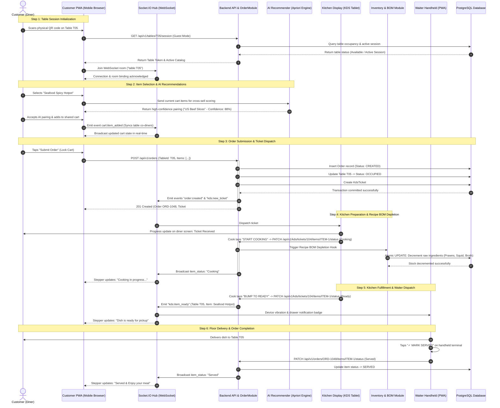
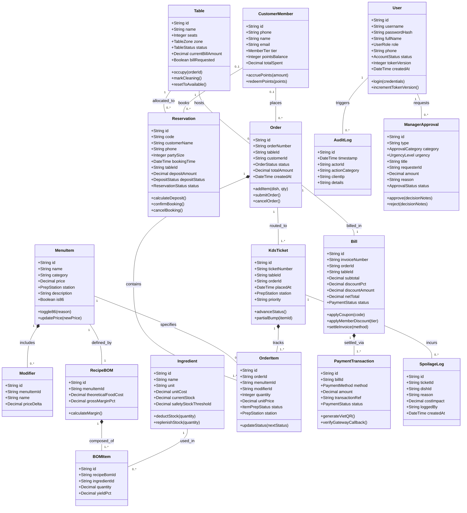

# CHAPTER 5. AI IN SOFTWARE DESIGN AND ARCHITECTURE
## PROJECT: OPERLY – RESTAURANT OPERATIONS AND PROFITABILITY MANAGEMENT

* **Course:** Advanced Software Engineering (Capstone Project)
* **Document:** Comprehensive Software Architecture and System Design Specification
* **Version:** 1.0.0 (Formal Academic Baseline)
* **Traceability Baseline:**
  * Chapter 3: Requirements Engineering (`docs/chapter3/product-requirements.md`, `feature-specification.md`)
  * Chapter 4: Product Design & Prototyping (`docs/chapter4/prototyping.md`, `ai-design-review.md`)
  * Empirical Codebase Baseline: React 18 Interactive Prototype (`prototype/`)

---

## CHAPTER PROLOGUE

Chapter 5 establishes the **Software Design and Architecture** for the Operly platform. While Chapter 3 defined the product scope, functional requirements (FRs), and strict non-functional constraints (NFRs), and Chapter 4 validated user journeys across six distinct roles via interactive wireframes and a functional prototype, Chapter 5 bridges the divide between behavioral specification and concrete engineering realization. It structures Operly into a robust, high-performance, maintainable, and extensible software system.

Crucially, this chapter details the **role of Artificial Intelligence (AI) across software engineering design workflows**: AI is employed as a rigorous co-pilot for exploring architectural alternatives, automating the synthesis of UML structural models from narrative requirements, validating relational database normalization, and auditing API contracts for edge-case vulnerabilities. Throughout this document, an empirical, evidence-based standard is enforced: all architectural claims are cross-referenced with actual repository artifacts, maintaining a strict distinction between **existing prototype implementations** and **proposed target production architectures**.

---

## 5.1. ARCHITECTURE DESIGN

### 5.1.1. Architectural Goals and Operational Constraints

Operly is architected to optimize full-service restaurant operations, orchestrating Front-of-House (FOH) dining areas, Back-of-House (BOH) kitchen prep stations, and administrative oversight. The architecture is governed by five non-negotiable engineering goals:

1. **Sub-Second Operational Synchronicity:** 
   Commercial food service is an interdependent physical workflow. State transitions must propagate across roles without delay (e.g., diner order placement $\rightarrow$ KDS prep queue routing $\rightarrow$ server dish delivery alert $\rightarrow$ cashier POS invoice calculation). The system mandates an end-to-end local network broadcast latency of $t_{\text{latency}} \le 2.0\text{ seconds}$ (NFR-3.1).
2. **ACID Transactional Integrity:** 
   Raw inventory deduction driven by recipe Bills of Materials (BOM), POS invoice settlements via dynamic VietQR, and deposit processing require strict atomicity, consistency, isolation, and durability. Race conditions and phantom inventory reads are unacceptable.
3. **High Throughput and Low API Latency:** 
   $95\%$ of transactional REST API endpoints must respond in $p95 \le 300\text{ ms}$ (NFR-3.1). Client-facing mobile interfaces accessed via on-table QR codes must load with zero installation, achieving a First Contentful Paint (FCP) $\le 1.8\text{ seconds}$ and Time to Interactive (TTI) $\le 2.5\text{ seconds}$.
4. **Multi-Role Security and Zero-Trust Session Revocation:** 
   Granular Role-Based Access Control (RBAC) covers six user roles (`Customer`, `Waiter`, `Kitchen Staff`, `Cashier`, `Manager`, `Administrator`). The architecture incorporates an instant session invalidation mechanism (`token_version`) to eliminate vulnerabilities associated with long-lived tokens when an employee is suspended.
5. **Modularity and Extensible AI Integration:** 
   High cohesion and low coupling between domain boundaries allow analytical AI services—such as Apriori food pairings and 7-day ARIMA demand forecasting—to integrate cleanly without introducing cross-module coupling.

### 5.1.2. Repository Implementation vs. Target Production Architecture

To maintain rigorous academic and engineering honesty, this specification distinguishes between the current workspace state and the target production architecture:

* **Current Repository Implementation (Interactive Prototype):** 
  Inspection of the repository reveals that application code is currently housed within `prototype/`. Built with **React 18.3.1**, **Vite 5.4.2**, **Lucide React**, and responsive CSS, this frontend prototype models the complete operational dining spine across all six roles. The multi-role reactive event engine is driven entirely by client-side React Context (`prototype/src/store/mockStore.jsx`, 861 LOC) backed by standardized static domain models (`prototype/src/mock/data.js`, 583 LOC). There is currently no active NestJS backend server, PostgreSQL database instance, or Prisma ORM migration file in the root workspace.
* **Target Production Architecture (Documented Specification):** 
  As established in `docs/chapter3/feature-specification.md`, the target enterprise platform is specified as a **Modular Monolith** powered by **NestJS** (Node.js framework with TypeScript), **PostgreSQL 16** managed via TypeORM or Prisma ORM, **Redis 7** for ephemeral session caching and WebSocket room management, and **Socket.IO** for duplex event streaming.

Consequently, Chapter 5 documents Operly’s architecture as a unified **Modular Monolith**, directly mapping the reactive state flows and business rules established in the prototype to their target server-side counterparts.

### 5.1.3. Separation of Concerns and Layer Responsibilities

The system architecture is structured into four distinct logical tiers:

1. **Presentation Tier (Client Applications):**
   * **Customer Web PWA:** Zero-install mobile browser application accessed via QR codes. Provides *Guest Mode* (anonymous table session binding) and *Member Mode* (phone-based loyalty authentication, points accrual, and tier discounts).
   * **Waiter Handheld PWA:** Single-handed thumb-zone interface (minimum $48 \times 48\text{ px}$ interactive touch targets) displaying real-time floor topology and receiving vibrational ready-dish alerts.
   * **Kitchen Display System (KDS):** Station-mounted tablet interface featuring high-contrast typography readable at 2 meters, chronological FIFO order queues, partial line-item bumping, and out-of-stock ("86") toggling.
   * **Cashier POS Terminal:** High-density desktop interface supporting checkout queue management, an unserved food blocking gate, cash rounding to 1,000 VND, dynamic VietQR generation, and split billing.
   * **Management & Administration Portal:** Executive dashboard rendering real-time KPIs, recipe BOM configuration with real-time margin calculations, urgent managerial approval drawers, 7-day AI demand forecasting, and immutable audit logs.
2. **Gateway and Security Tier:**
   * Operates as the entry point, handling TLS 1.3 termination, rate limiting, and Web Application Firewall (WAF) filtering.
   * Dispatches incoming traffic to REST controllers or the Socket.IO WebSocket router.
   * Executes authentication and authorization filters (`JwtAuthGuard`, `TokenVersionGuard`, `RbacGuard`).
3. **Application Tier (NestJS Modular Monolith):**
   * Encapsulates core business domains into decoupled modules: `AuthModule`, `TableReservationModule`, `OrderSharedCartModule`, `KdsDispatchModule`, `BillingPaymentModule`, `InventoryBomModule`, `StaffAttendanceModule`, and `AiAnalyticsModule`.
   * Inter-module communication relies on Dependency Injection and in-process asynchronous event dispatching (`EventEmitter2`), preventing uncontrolled cross-table mutations.
4. **Data and Storage Tier:**
   * **PostgreSQL 16:** Relational database ensuring strict ACID compliance, foreign-key referential integrity, and normalized transactional data storage.
   * **Redis 7:** In-memory key-value store for Socket.IO room states, ephemeral shared cart sessions, and token revocation lists.
   * **Object Storage (Cloudinary / AWS S3):** Secure storage for menu imagery, digital receipts, and audit snapshots.

### 5.1.4. System Architecture Diagram

Figure 5.1 illustrates the complete multi-tier architecture of Operly:

```mermaid
flowchart TD
    %% OPERLY SYSTEM ARCHITECTURE DIAGRAM
    %% Representation of the Multi-Tier Modular Monolith Architecture

    subgraph CLIENT_TIER["Presentation Tier (Client Applications)"]
        direction LR
        CUST_APP["Customer Web App<br/>(QR / Web PWA)<br/><i>React 18 / Mobile Browser</i>"]
        WAIT_APP["Waiter Handheld App<br/>(Floor Server PWA)<br/><i>React 18 / Touch Ergonomics</i>"]
        KDS_APP["Kitchen Display System<br/>(KDS Station Tablet)<br/><i>React 18 / 2-Meter Contrast</i>"]
        POS_APP["Cashier POS Terminal<br/>(Checkout Desktop / Tablet)<br/><i>React 18 / Split-Bill & VietQR</i>"]
        MGR_APP["Management Portal<br/>(Manager & Admin Console)<br/><i>React 18 / BI Analytics</i>"]
    end

    subgraph GATEWAY_TIER["Gateway & Security Tier"]
        direction TB
        REVERSE_PROXY["Reverse Proxy & Load Balancer<br/>(Nginx / Cloudflare)<br/><i>TLS 1.3, Rate Limiting, WAF</i>"]
        AUTH_GUARD["Authentication & Authorization Interceptor<br/>(JWT & Token Versioning Guard)<br/><i>RBAC Interceptor</i>"]
    end

    subgraph APP_TIER["Application Tier (Nest.js Modular Monolith)"]
        direction TB
        
        subgraph ENTRY_POINTS["Entry Gateways"]
            REST_CTRL["REST API Controllers<br/><i>DTOs & Validation Pipes</i>"]
            WS_GATEWAY["WebSocket Real-Time Gateway<br/>(Socket.IO Hub)<br/><i>Table & Station Rooms</i>"]
        end

        subgraph CORE_MODULES["Core Business Modules"]
            AUTH_MOD["Authentication & RBAC Module<br/>(AuthModule)<br/><i>JWT & Session Revocation</i>"]
            TABLE_RES_MOD["Table & Reservation Module<br/>(TableReservationModule)<br/><i>90-Min Conflict Engine</i>"]
            ORDER_MOD["Order & Shared Cart Module<br/>(OrderSharedCartModule)<br/><i>Multi-Diner Cart Sync</i>"]
            KDS_MOD["Kitchen Dispatch Module<br/>(KdsDispatchModule)<br/><i>FIFO & Station Routing</i>"]
            BILL_MOD["Billing & Payment Module<br/>(BillingPaymentModule)<br/><i>Split-Bill & VietQR Generator</i>"]
            INV_MOD["Inventory & BOM Module<br/>(InventoryBomModule)<br/><i>Depletion at Cooking & Spoilage</i>"]
            STAFF_MOD["Staff & Attendance Module<br/>(StaffAttendanceModule)<br/><i>Haversine GPS & Wi-Fi Check</i>"]
        end

        subgraph AI_SERVICES["Embedded AI Services"]
            AI_REC["AI Food Recommender<br/>(Apriori Association Engine)<br/><i>Co-occurrence Scoring</i>"]
            AI_FORECAST["Demand & Sales Forecaster<br/>(ARIMA / Prophet Worker)<br/><i>7-Day Forecast & 95% CI</i>"]
        end
    end

    subgraph DATA_TIER["Data & Storage Tier"]
        direction LR
        POSTGRES_DB[("Relational Database<br/>PostgreSQL 16<br/><i>ACID Transactions, Normalized Schema</i>")]
        REDIS_CACHE[("In-Memory Data Store<br/>Redis 7 Cache<br/><i>Socket Rooms, Ephemeral Cart, Token Revoke</i>")]
        BLOB_STORAGE[("Object Storage<br/>Cloudinary / AWS S3<br/><i>Dish Media, Receipt Archives</i>")]
    end

    subgraph EXTERNAL_TIER["External Integrations Tier"]
        direction TB
        VIETQR_GATEWAY["Banking Payment Gateway<br/>(VietQR / NAPAS EMVCo)<br/><i>Dynamic QR & Webhook Callbacks</i>"]
        NOTIF_SERVICE["SMS / ZNS Notification Service<br/>(Twilio / Zalo Cloud)<br/><i>Booking Confirmations & Alerts</i>"]
    end

    %% Communication Connections
    CUST_APP <-->|HTTPS / WSS| REVERSE_PROXY
    WAIT_APP <-->|HTTPS / WSS| REVERSE_PROXY
    KDS_APP <-->|HTTPS / WSS| REVERSE_PROXY
    POS_APP <-->|HTTPS / WSS| REVERSE_PROXY
    MGR_APP <-->|HTTPS / WSS| REVERSE_PROXY

    REVERSE_PROXY --> AUTH_GUARD
    AUTH_GUARD --> REST_CTRL
    AUTH_GUARD --> WS_GATEWAY

    REST_CTRL --> CORE_MODULES
    WS_GATEWAY --> CORE_MODULES

    ORDER_MOD <--> AI_REC
    BILL_MOD <--> AI_FORECAST
    INV_MOD <--> AI_FORECAST

    CORE_MODULES <-->|TypeORM / Prisma ORM| POSTGRES_DB
    CORE_MODULES <-->|ioredis Client| REDIS_CACHE
    TABLE_RES_MOD -.->|Upload Images| BLOB_STORAGE
    INV_MOD -.->|Upload Images| BLOB_STORAGE

    BILL_MOD <-->|REST Webhooks| VIETQR_GATEWAY
    TABLE_RES_MOD -->|REST API Dispatch| NOTIF_SERVICE
```



*Figure 5.1: Overall System Architecture Diagram for Operly (Source: [architecture.mmd](diagrams/architecture.mmd))*

### 5.1.5. AI-Assisted Architectural Exploration and Trade-Off Analysis

During the system design phase, AI models served as an analytical sounding board to evaluate architectural paradigms against project constraints:

| Evaluation Dimension | Traditional Monolith | Microservices Architecture | Modular Monolith (Selected Architectural Baseline) |
| :--- | :--- | :--- | :--- |
| **Operational & DevOps Overhead** | Low (Single deployment unit) | Extremely High (Kubernetes, Service Mesh, Distributed Tracing) | **Low to Moderate** (Single deployable container, simplified CI/CD pipeline) |
| **Cross-Module Network Latency** | In-memory function execution | High (HTTP/gRPC network hops across microservice boundaries) | **Near-Zero** (In-memory Dependency Injection and internal event bus) |
| **Transactional Consistency (ACID)** | High (Single database transaction) | Very Low (Requires Saga patterns, 2-Phase Commit, Eventual Consistency) | **High** (Guaranteed ACID transactions in single PostgreSQL database) |
| **Domain Boundary Enforcement** | Poor (Prone to circular dependencies and spaghetti coupling) | Absolute (Physical separation across independent codebases) | **Strong** (Enforced through NestJS module encapsulation and public interfaces) |
| **Suitability for Mid-Sized Restaurant** | Suitable initially, degrades with scale | Unsuitable (Severe operational overhead and excessive infrastructure costs) | **Optimal** (Balances domain decoupling with operational efficiency) |

*Table 5.1: Comparative Analysis of Architectural Alternatives Evaluated with AI Assistance*

**Human Engineering Verification:** While AI exploration highlighted the theoretical scaling benefits of a microservices approach, human engineering review rejected it. In a standalone restaurant environment, microservices introduce unacceptable risks: network partitions during meal service can derail real-time orders, and distributed transactions undermine the atomic consistency required for recipe BOM inventory depletion. The **Modular Monolith** was confirmed as the optimal architectural strategy.

---

## 5.2. ARCHITECTURE PATTERNS

This section examines the concrete architectural patterns applied across the Operly codebase and system design.

### 5.2.1. Modular Monolith Pattern
* **Core Concept:** The application is packaged and deployed as a single runtime artifact, while its internal codebase is strictly partitioned into domain-specific modules. Modules expose clear public interfaces and keep internal data access logic private.
* **Application in Operly:** 
  In the prototype, modular boundaries are reflected in the directory structure (`CustomerQRMenuScreen`, `KitchenKDSScreen`, `CashierPOSScreen`, `ManagerPortalScreen`, `AdminConsoleScreen`). In the target NestJS backend, each business area is encapsulated in a dedicated module (`OrderModule`, `KdsModule`, `InventoryModule`), ensuring that domain rules remain isolated.
* **Benefits & Trade-Offs:** Provides clean architectural boundaries without the operational complexity or latency of distributed networks, though it requires strict code reviews to prevent leaky abstractions.

### 5.2.2. Layered (N-Tier) Pattern
* **Core Concept:** Organizes system responsibilities into hierarchical horizontal layers, where each layer depends only on the abstraction beneath it.
* **Application in Operly:**
  1. *Presentation Layer:* REST Controllers and WebSocket Gateways parse incoming requests, validate DTOs, and format JSON responses.
  2. *Application / Service Layer:* Dedicated services (`OrderService`, `BomDepletionService`, `BillingService`) execute core business rules and algorithms.
  3. *Domain / Persistence Layer:* Data entities and TypeORM/Prisma repositories interact with PostgreSQL.
* **Benefits:** Establishes a clean separation of concerns, enabling comprehensive unit testing of business logic independent of external transport protocols or database drivers.

### 5.2.3. Hybrid Client-Server Communication Pattern
* **Core Concept:** Couples stateless HTTP RESTful APIs with persistent, bidirectional WebSocket streams within a unified application infrastructure.
* **Application in Operly:** 
  Standard data operations (fetching menus, executing payments, viewing rosters) operate over stateless REST endpoints. Concurrently, operational events—such as shared cart updates (`cart:item_added`), kitchen ticket bumps (`kds:item_status_bump`), server ready alerts (`waiter:ready_alert`), and emergency stockouts (`menu:86_toggle`)—flow through the Socket.IO event bus.
* **Benefits:** Minimizes server overhead by keeping standard queries stateless while delivering the sub-second responsiveness demanded by busy restaurant floors.

### 5.2.4. Role-Based Access Control (RBAC) with Token Versioning
* **Core Concept:** Restricts system operations based on defined organizational roles, augmented with an instantaneous session invalidation counter (`token_version`).
* **Application in Operly:** 
  Verified in `prototype/src/screens/AdminConsoleScreen.jsx` and `prototype/src/mock/data.js` (`MOCK_STAFF_ACCOUNTS`). The platform supports six roles: `Customer`, `Waiter`, `Kitchen Staff`, `Cashier`, `Manager`, `Administrator`.
* **Token Versioning Mechanism:** 
  Standard stateless JWTs cannot be revoked prior to expiration without heavy database session lookups. Operly resolves this by storing a `token_version` integer in the `users` table (cached in Redis). When an administrator suspends an employee, their `token_version` is incremented. On every subsequent request, the `TokenVersionGuard` compares the JWT's embedded version against the live counter. If mismatched, the request is immediately rejected with `HTTP 401 Unauthorized`.

---

## 5.3. SYSTEM MODELING AND UML (SYSTEM MODELING AND UML)

This section presents the formal UML models for Operly, derived directly from validated requirements and source implementations.

### 5.3.1. Use Case Diagram

The use case model captures the interactions of all six actors across 24 core use cases:

```mermaid
flowchart LR
    %% OPERLY SYSTEM USE CASE DIAGRAM
    %% Mapping all 6 Actors to Core System Use Cases

    subgraph ACTORS["System Actors"]
        direction TB
        ACT_CUST["Customer"]
        ACT_WAIT["Waiter"]
        ACT_KCH["Kitchen Staff"]
        ACT_CSH["Cashier"]
        ACT_MGR["Restaurant Manager"]
        ACT_ADM["System Administrator"]
    end

    subgraph SYSTEM_BOUNDARY["Operly Restaurant Management Platform"]
        direction TB

        subgraph UC_GRP_ORDER["Ordering & Reservation Subsystem"]
            UC_RES(["UC-01: Online Reservation & Advance Deposit"]):::coreUC
            UC_MENU(["UC-02: QR Code Scanning & Menu Browsing"]):::coreUC
            UC_CART(["UC-03: Shared Table Cart Synchronization"]):::coreUC
            UC_AI_REC(["UC-04: AI Apriori Food Recommendation"]):::aiUC
            UC_SUBMIT(["UC-05: Order Placement & Progress Tracking"]):::coreUC
            UC_CALL(["UC-06: Call Waiter / Pre-print Bill Request"]):::coreUC
        end

        subgraph UC_GRP_FLOOR["Floor Topology & Service Subsystem"]
            UC_FLOOR(["UC-07: Real-Time Floor Plan Monitoring"]):::coreUC
            UC_SERVE(["UC-08: Ready Alert Handling & Dish Delivery"]):::coreUC
            UC_RESET(["UC-09: Table Sanitization & Status Reset"]):::coreUC
        end

        subgraph UC_GRP_KITCHEN["Kitchen Display (KDS) Subsystem"]
            UC_KDS(["UC-10: FIFO Prep Queue & Station Routing"]):::coreUC
            UC_BUMP(["UC-11: Item Status Bump & Partial 1/2 Split"]):::coreUC
            UC_SPOIL(["UC-12: Kitchen Spoilage Logging & Re-fire"]):::coreUC
            UC_86(["UC-13: Instant 86 Out-of-Stock Toggle"]):::coreUC
        end

        subgraph UC_GRP_POS["POS Checkout & Billing Subsystem"]
            UC_CHECKOUT(["UC-14: Settlement Queue & Bill Management"]):::coreUC
            UC_GATE(["UC-15: Unserved Dish Blocking Gate Check"]):::coreUC
            UC_LOYALTY(["UC-16: Loyalty Lookup & Discount Clamping"]):::coreUC
            UC_VIETQR(["UC-17: Dynamic VietQR & Split-Bill Settle"]):::coreUC
        end

        subgraph UC_GRP_MGR["Management & Intelligence Subsystem"]
            UC_BOM(["UC-18: Recipe BOM & Margin Configuration"]):::coreUC
            UC_BI_AI(["UC-19: 7-Day AI Sales & Demand Forecasting"]):::aiUC
            UC_APPROVE(["UC-20: Urgent Operations & Void Approvals"]):::coreUC
            UC_ATTEND(["UC-21: Rostering & Geofenced Attendance"]):::coreUC
        end

        subgraph UC_GRP_ADM["Security & Governance Subsystem"]
            UC_RBAC(["UC-22: RBAC Staff Provisioning & Roles"]):::coreUC
            UC_REVOKE(["UC-23: Instant Session Revoke via Token Version"]):::coreUC
            UC_AUDIT(["UC-24: Immutable System Audit Trail Explorer"]):::coreUC
        end
    end

    %% Customer Relationships
    ACT_CUST --> UC_RES
    ACT_CUST --> UC_MENU
    ACT_CUST --> UC_CART
    ACT_CUST --> UC_SUBMIT
    ACT_CUST --> UC_CALL
    UC_CART -.->|"<<include>>"| UC_AI_REC

    %% Waiter Relationships
    ACT_WAIT --> UC_FLOOR
    ACT_WAIT --> UC_SERVE
    ACT_WAIT --> UC_RESET
    ACT_WAIT --> UC_CART

    %% Kitchen Staff Relationships
    ACT_KCH --> UC_KDS
    ACT_KCH --> UC_BUMP
    ACT_KCH --> UC_SPOIL
    ACT_KCH --> UC_86

    %% Cashier Relationships
    ACT_CSH --> UC_CHECKOUT
    ACT_CSH --> UC_LOYALTY
    ACT_CSH --> UC_VIETQR
    UC_CHECKOUT -.->|"<<include>>"| UC_GATE

    %% Manager Relationships
    ACT_MGR --> UC_BOM
    ACT_MGR --> UC_BI_AI
    ACT_MGR --> UC_APPROVE
    ACT_MGR --> UC_ATTEND
    ACT_MGR --> UC_FLOOR

    %% Administrator Relationships
    ACT_ADM --> UC_RBAC
    ACT_ADM --> UC_REVOKE
    ACT_ADM --> UC_AUDIT

    %% Styling
    classDef coreUC fill:#e1f5fe,stroke:#0288d1,stroke-width:1.5px;
    classDef aiUC fill:#ede7f6,stroke:#7e57c2,stroke-width:2px;
```



*Figure 5.2: System-Wide Use Case Diagram for Operly (Source: [use-case.mmd](diagrams/use-case.mmd))*

### 5.3.2. Component Diagram

The component diagram details the interaction between client presentation bundles, intermediate infrastructure, and the backend application modules:

```mermaid
flowchart TB
    %% OPERLY COMPONENT DIAGRAM
    %% Component architecture detailing Frontend, Backend Nest.js Modules, and Data Stores

    subgraph FRONTEND_SYSTEM["Frontend Presentation System (React 18 / TypeScript)"]
        direction TB
        
        subgraph FE_CLIENTS["User Role Presentation Modules"]
            FE_CUST["Customer Module<br/>(QR Menu, Shared Cart,<br/>Progress Stepper, Reservation)"]
            FE_WAIT["Waiter Module<br/>(Floor Topo, Ready Alerts,<br/>Table Clean Reset)"]
            FE_KDS["Kitchen KDS Module<br/>(FIFO Board, Station Filter,<br/>Bump Controller, 86 Modal)"]
            FE_POS["Cashier POS Module<br/>(Checkout Queue, Discount Cap,<br/>Split-Bill, VietQR Modal)"]
            FE_MGR["Manager & Admin Module<br/>(BI Dashboard, AI Forecast,<br/>Recipe BOM, RBAC & Audit)"]
        end

        subgraph FE_CORE["Frontend Infrastructure & State"]
            FE_STATE["Synchronized State Engine<br/>(mockStore / Redux Toolkit / React Query)"]
            FE_HTTP["HTTP API Client Services<br/>(Axios / Fetch Interceptors)"]
            FE_WS["WebSocket Client Hub<br/>(Socket.IO Client Hub)"]
        end

        FE_CLIENTS --> FE_STATE
        FE_STATE --> FE_HTTP
        FE_STATE --> FE_WS
    end

    subgraph BACKEND_SYSTEM["Backend System (Nest.js Modular Monolith)"]
        direction TB

        subgraph BE_INFRA["Gateway & Security Infrastructure"]
            BE_AUTH_GUARD["Authentication & RBAC Interceptors<br/>(JwtAuthGuard & RbacGuard)"]
            BE_TOKEN_CHECK["Session Revocation Verifier<br/>(TokenVersionInterceptor)"]
            BE_WS_GATEWAY["Duplex Message Dispatcher<br/>(SocketIoGateway)"]
        end

        subgraph BE_MODULES["Core Business Domain Modules"]
            MOD_AUTH["AuthModule<br/><i>(AuthController, AuthService,<br/>PasswordHasher)</i>"]
            MOD_TABLE["TableReservationModule<br/><i>(TableController, ResController,<br/>ConflictDetectionEngine)</i>"]
            MOD_ORDER["OrderCartModule<br/><i>(OrderController, SharedCartHub,<br/>OrderProcessingService)</i>"]
            MOD_KDS["KdsDispatchModule<br/><i>(KdsController, StationRouter,<br/>BumpStateService)</i>"]
            MOD_BILL["BillingPaymentModule<br/><i>(BillingController, VietQrEngine,<br/>SplitPaymentService)</i>"]
            MOD_INV["InventoryBomModule<br/><i>(InventoryController, BomDepletionEngine,<br/>SpoilageLedgerService)</i>"]
            MOD_STAFF["StaffAttendanceModule<br/><i>(StaffController, HaversineGeofence,<br/>AttendanceService)</i>"]
            MOD_AI["AiEngineModule<br/><i>(AprioriRecommenderService,<br/>ArimaForecastWorker)</i>"]
        end

        BE_INFRA --> BE_MODULES
        MOD_ORDER <-->|Trigger pairings| MOD_AI
        MOD_ORDER -->|Push tickets| MOD_KDS
        MOD_KDS -->|Trigger stock depletion| MOD_INV
        MOD_ORDER -->|Feed bill ledger| MOD_BILL
        MOD_BILL <-->|Supply revenue data| MOD_AI
    end

    subgraph PERSISTENCE_TIER["Persistence & External Integration Tier"]
        direction LR
        DB_POSTGRES[("PostgreSQL 16 Database<br/><i>Relational Tables, ACID Trans</i>")]
        CACHE_REDIS[("Redis In-Memory Cache<br/><i>Active Cart Rooms, Token Cache</i>")]
        EXT_VIETQR["VietQR Payment Provider<br/><i>Dynamic QR API & Webhook</i>")]
    end

    %% Cross-Tier Communication
    FE_HTTP -->|HTTPS REST| BE_AUTH_GUARD
    FE_WS <-->|WSS Socket.IO| BE_WS_GATEWAY

    BE_MODULES <-->|TypeORM / Prisma Data Access| DB_POSTGRES
    BE_MODULES <-->|ioredis Data Access| CACHE_REDIS
    MOD_BILL <-->|HTTPS Webhook| EXT_VIETQR
```

*Figure 5.3: System Component Diagram for Operly (Source: [component.mmd](diagrams/component.mmd))*

### 5.3.3. Order Lifecycle Sequence Diagram

The dining sequence represents the primary operational spine of the restaurant. Figure 5.4 details the end-to-end flow from customer QR scan to kitchen preparation, recipe BOM depletion, and waiter delivery:



*Figure 5.4: End-to-End Order Lifecycle Sequence Diagram (Source: [order-sequence.mmd](diagrams/order-sequence.mmd))*

### 5.3.4. Domain Class Diagram

The domain model captures core domain entities, attributes, operations, and multiplicities:



*Figure 5.5: Domain Model and Class Diagram for Operly (Source: [domain-class.mmd](diagrams/domain-class.mmd))*

### 5.3.5. AI-Assisted UML Modeling and Human Verification Workflows

AI tooling accelerated the UML modeling process across three phases:
1. **Requirements-to-Actor Mapping:** Natural language processing extracted candidate actors and use case clusters from PRD v1.1, mapping functional requirements to subsystem boundaries.
2. **Diagrams-as-Code Synthesis:** AI synthesized text-based Mermaid code directly, facilitating version control in Git.
3. **Discrepancy and Anomaly Detection:** AI cross-audited sequence diagrams against `prototype/src/store/mockStore.jsx`. It flagged an initial discrepancy where the draft sequence diagram decremented inventory when the customer submitted the order, whereas the codebase enforces depletion *only when the kitchen cook bumps the item to Cooking*. The model was promptly corrected.

---

## 5.4. DATABASE DESIGN

### 5.4.1. Database Engine and Data Access Architecture

Operly selects **PostgreSQL 16** as its relational database management system, driven by four technical requirements:
* Full ACID transactional guarantees, ensuring reliable inventory depletion and financial balance calculations.
* Native `JSONB` support, enabling structured storage of raw bank webhook payloads and audit log details alongside normalized relational tables.
* Row-level locking (`SELECT ... FOR UPDATE`), preventing concurrent modification anomalies when multiple terminals access the same table or ticket.
* Seamless ORM integration with **Prisma ORM** and **TypeORM**, supporting type-safe queries and version-controlled migration scripts.

### 5.4.2. Entity Relationship Diagram (ERD)

Figure 5.6 documents the complete 20-entity relational schema:

```mermaid
erDiagram
    %% OPERLY DATABASE ENTITY RELATIONSHIP DIAGRAM (ERD)
    %% Production PostgreSQL Relational Schema for Operly

    users ||--o{ audit_logs : "triggers"
    users ||--o{ manager_approvals : "requests"
    users ||--o{ manager_approvals : "approves"
    users ||--o{ staff_shifts : "attends"
    users ||--o{ kitchen_spoilage_logs : "logs"

    customer_members ||--o{ reservations : "books"
    customer_members ||--o{ orders : "places"
    customer_members ||--o{ bills : "receives"

    restaurant_tables ||--o{ reservations : "allocated_to"
    restaurant_tables ||--o{ orders : "hosts"
    restaurant_tables ||--o{ bills : "settles"

    menu_categories ||--o{ menu_items : "contains"
    menu_items ||--o{ dish_modifiers : "has"
    menu_items ||--|| recipe_boms : "defined_by"
    menu_items ||--o{ order_items : "selected_in"
    menu_items ||--o{ kitchen_spoilage_logs : "spoiled_in"

    recipe_boms ||--|{ recipe_bom_items : "composed_of"
    ingredients ||--o{ recipe_bom_items : "used_in"

    orders ||--|{ order_items : "contains"
    orders ||--o{ kds_tickets : "dispatched_as"
    orders ||--|| bills : "billed_in"

    kds_tickets ||--|{ kds_ticket_items : "includes"
    order_items ||--o{ kds_ticket_items : "mapped_to"
    kds_tickets ||--o{ kitchen_spoilage_logs : "records"

    bills ||--|{ payment_transactions : "paid_by"

    users {
        uuid id PK
        varchar_50 username
        varchar_100 email
        varchar_255 password_hash
        varchar_100 full_name
        varchar_20 phone
        varchar_30 role
        varchar_20 status
        integer token_version
        timestamp created_at
        timestamp updated_at
    }

    customer_members {
        uuid id PK
        varchar_20 phone UK
        varchar_100 full_name
        varchar_100 email
        varchar_20 member_tier
        integer points_balance
        decimal total_spent
        timestamp created_at
    }

    restaurant_tables {
        uuid id PK
        varchar_10 table_number UK
        integer seating_capacity
        varchar_50 zone
        varchar_20 status
        uuid current_order_id
        timestamp created_at
    }

    reservations {
        uuid id PK
        varchar_20 booking_code UK
        varchar_100 customer_name
        varchar_20 customer_phone
        integer party_size
        timestamp reservation_time
        uuid table_id FK
        decimal deposit_required
        decimal deposit_paid
        varchar_20 deposit_status
        varchar_20 status
        timestamp created_at
    }

    menu_categories {
        uuid id PK
        varchar_50 name
        integer display_order
        boolean is_active
    }

    menu_items {
        uuid id PK
        uuid category_id FK
        varchar_150 name
        text description
        decimal base_price
        varchar_50 prep_station
        boolean is_86
        varchar_255 disabled_reason
        varchar_255 image_url
        timestamp created_at
    }

    dish_modifiers {
        uuid id PK
        uuid menu_item_id FK
        varchar_100 modifier_name
        decimal price_delta
        boolean is_active
    }

    recipe_boms {
        uuid id PK
        uuid menu_item_id FK
        decimal theoretical_cost
        decimal gross_margin_pct
        timestamp updated_at
    }

    ingredients {
        uuid id PK
        varchar_50 sku UK
        varchar_150 name
        varchar_20 unit_of_measure
        decimal unit_cost
        decimal current_stock
        decimal safety_threshold
        timestamp updated_at
    }

    recipe_bom_items {
        uuid id PK
        uuid recipe_bom_id FK
        uuid ingredient_id FK
        decimal quantity_grams
        decimal yield_pct
    }

    orders {
        uuid id PK
        varchar_30 order_code UK
        uuid table_id FK
        uuid member_id FK
        varchar_20 order_type
        varchar_20 status
        decimal subtotal_amount
        decimal total_amount
        timestamp created_at
    }

    order_items {
        uuid id PK
        uuid order_id FK
        uuid menu_item_id FK
        uuid modifier_id FK
        integer quantity
        decimal unit_price_snapshot
        varchar_20 prep_status
        varchar_50 prep_station
        varchar_255 special_notes
        timestamp created_at
    }

    kds_tickets {
        uuid id PK
        varchar_20 ticket_number UK
        uuid order_id FK
        uuid table_id FK
        varchar_50 station
        varchar_20 priority
        integer elapsed_minutes
        varchar_20 status
        timestamp created_at
    }

    kds_ticket_items {
        uuid id PK
        uuid ticket_id FK
        uuid order_item_id FK
        varchar_20 item_status
        timestamp updated_at
    }

    bills {
        uuid id PK
        varchar_30 invoice_number UK
        uuid order_id FK
        uuid table_id FK
        uuid member_id FK
        decimal subtotal
        decimal discount_pct
        decimal discount_amount
        decimal net_total
        varchar_20 payment_status
        timestamp created_at
    }

    payment_transactions {
        uuid id PK
        uuid bill_id FK
        varchar_30 payment_method
        varchar_100 transaction_ref
        decimal amount
        jsonb gateway_response
        varchar_20 status
        timestamp settled_at
    }

    kitchen_spoilage_logs {
        uuid id PK
        uuid ticket_id FK
        uuid menu_item_id FK
        varchar_100 reason
        decimal cost_impact_vnd
        boolean is_refired
        uuid logged_by_id FK
        timestamp created_at
    }

    staff_shifts {
        uuid id PK
        uuid staff_id FK
        date shift_date
        varchar_50 shift_name
        timestamp check_in_time
        varchar_30 check_in_method
        varchar_20 attendance_status
        integer tables_served
    }

    manager_approvals {
        uuid id PK
        varchar_50 request_type
        varchar_30 category
        varchar_20 urgency
        varchar_255 title
        uuid requester_id FK
        uuid table_id FK
        decimal amount
        text reason
        varchar_20 status
        uuid processed_by_id FK
        timestamp processed_at
    }

    audit_logs {
        uuid id PK
        timestamp timestamp
        uuid actor_id FK
        varchar_50 action_category
        varchar_45 client_ip
        text details
    }
```



*Figure 5.6: PostgreSQL Relational Entity Relationship Diagram for Operly (Source: [database-erd.mmd](diagrams/database-erd.mmd))*

### 5.4.3. Data Normalization and Integrity Rules

1. **Third Normal Form (3NF) Compliance:**
   * Entities such as Menu Items (`menu_items`), Recipe BOMs (`recipe_boms`), and Bill of Materials Items (`recipe_bom_items`) are strictly decomposed to eliminate transitive dependencies. When ingredient unit costs fluctuate, theoretical dish costs recalculate dynamically without data anomalies.
2. **Controlled Denormalization for Financial Immutability:**
   * The `order_items` table deliberately records `unit_price_snapshot`. 
   * **Design Rationale:** Menu pricing changes must never alter historical sales data or settled customer receipts.
3. **Append-Only Immutable Audit Trail:**
   * The `audit_logs` entity is append-only; database-level permissions explicitly revoke `UPDATE` and `DELETE` operations. This ensures a tamper-proof record of sensitive actions, including bill voids (`BILL_VOID`), discount overrides (`DISCOUNT_OVERRIDE`), and user suspensions (`USER_SUSPENDED`).

---

## 5.5. API DESIGN

This section synthesizes the API architecture. Complete DTO validation specifications, Socket.IO matrices, and error envelopes are detailed in [API Design Specification](api-design.md).

### 5.5.1. Communication Model and Endpoint Organization

Operly employs a dual-protocol approach:
* **RESTful JSON API:** Standardized resource URIs (`/api/v1/...`) using appropriate HTTP verbs (`GET`, `POST`, `PATCH`, `DELETE`).
* **WebSocket Streams:** Scoped Socket.IO rooms (`table:{id}`, `station:{id}`) that limit event broadcast traffic to relevant client devices.

### 5.5.2. Representative API Endpoints Summary

The following table summarizes core endpoints across the platform:

| Module | Method | Endpoint | Purpose | Authentication / Authorization | Implementation Status |
| :--- | :---: | :--- | :--- | :--- | :--- |
| **Auth & RBAC** | `POST` | `/api/v1/auth/login` | Authenticates staff via phone/email and password | Public (Unrestricted) | Mock Verified / Proposed Nest.js |
| **Auth & RBAC** | `PATCH` | `/api/v1/admin/users/:id/suspend` | Suspends staff and increments `token_version` to revoke sessions | Administrator | Implemented in Prototype (`toggleStaffStatus`) |
| **Table & Res** | `GET` | `/api/v1/tables` | Retrieves real-time floor topology and table states | Waiter, Cashier, Manager | Implemented in Prototype (`tables`) |
| **Table & Res** | `POST` | `/api/v1/reservations` | Books table online, checks 90-min buffer, calculates deposit | Public (Customer) | Implemented in Prototype (`createReservation`) |
| **Menu & Catalog**| `PATCH` | `/api/v1/menu/items/:id/86` | Toggles item 86 out-of-stock state across all customer menus | Kitchen Staff, Manager | Implemented in Prototype (`toggle86Item`) |
| **AI Recommender**| `POST` | `/api/v1/ai/recommendations/pairings` | Computes Apriori cross-sell food pairings based on cart state | Public (Table Diner) | Implemented in Prototype (`MOCK_AI_PAIRINGS`) |
| **Order & Cart** | `POST` | `/api/v1/orders` | Dispatches cart items to KDS, locking table to Occupied | Table Diners | Implemented in Prototype (`submitCustomerOrder`) |
| **Kitchen KDS** | `PATCH` | `/api/v1/kds/tickets/:id/items/:itemId/status` | Advances item status (Pending $\rightarrow$ Cooking $\rightarrow$ Ready) | Kitchen Staff | Implemented in Prototype (`advanceTicketItemStatus`) |
| **Kitchen KDS** | `POST` | `/api/v1/kds/tickets/:id/items/:itemId/spoilage` | Logs food waste/spoilage, computes loss, and triggers re-fire | Kitchen Staff, Manager | Implemented in Prototype (`logSpoilage`) |
| **Billing & POS**| `POST` | `/api/v1/pos/bills/vietqr` | Generates dynamic EMVCo VietQR payment payload | Cashier | Implemented in Prototype (`SCR-POS-03`) |
| **Billing & POS**| `POST` | `/api/v1/pos/bills/settle` | Finalizes settlement with unserved item validation gate | Cashier | Implemented in Prototype (`recordSettlement`) |
| **Inventory BOM**| `PUT` | `/api/v1/inventory/bom/:dishId` | Configures raw ingredient quantities and yields for dish BOM | Manager | Implemented in Prototype (`updateBOMQuantity`) |
| **Staff & HR** | `POST` | `/api/v1/staff/attendance/clock-in` | Validates attendance via Haversine GPS ($\le 50\text{m}$) or Wi-Fi | Waiter, Kitchen, Cashier | Proposed Nest.js (Haversine Engine) |
| **AI Analytics** | `GET` | `/api/v1/analytics/forecast/7-day` | Fetches 7-day ARIMA/Prophet revenue and covers forecast (95% CI)| Manager, Administrator | Implemented in Prototype (`MOCK_AI_FORECAST`) |
| **Audit Logs** | `GET` | `/api/v1/admin/audit-logs` | Queries immutable system audit trail with multi-facet filters | Administrator | Implemented in Prototype (`auditLogs`) |

*Table 5.2: Representative API Endpoints for Operly (For full catalog, see [api-design.md](api-design.md))*

---

## 5.6. DESIGN PATTERNS

This section details the software design patterns implemented or targeted across the codebase.

### 5.6.1. Dependency Injection and Inversion of Control (DI/IoC)
* **Concept:** Externalizes component dependencies, supplying them at runtime rather than hardcoding them within class constructors.
* **Application in Operly:** 
  Foundational to the target NestJS framework. For instance, `OrderService` receives injected instances of `OrderRepository`, `KdsGateway`, and `BomDepletionService` via constructor injection.
* **Benefits:** Eliminates hard couplings, facilitating comprehensive unit testing via mock dependencies.

```typescript
@Injectable()
export class OrderService {
  constructor(
    @InjectRepository(Order) private readonly orderRepo: Repository<Order>,
    private readonly kdsGateway: KdsGateway,
    private readonly bomService: BomDepletionService,
  ) {}
  
  async submitOrder(createOrderDto: CreateOrderDto): Promise<Order> {
    // Executes order creation and emits KDS events
  }
}
```

### 5.6.2. Strategy Pattern
* **Concept:** Defines a family of interchangeable algorithms, enabling runtime strategy selection without altering calling classes.
* **Application in Operly:** 
  Utilized in POS settlement (`BillingPaymentModule`). Payment calculations implement a common `PaymentProcessingStrategy` interface across `VietQrPaymentStrategy`, `CashRoundingStrategy`, and `CreditCardStrategy`.
* **Benefits:** Adheres to the Open/Closed Principle (OCP); new payment methods (e.g., Apple Pay) can be added without modifying existing settlement workflows.

### 5.6.3. Observer / Event-Driven Pattern
* **Concept:** Establishes a one-to-many dependency where state changes trigger automated notifications across subscribed listeners.
* **Application in Operly:** 
  When a kitchen ticket transitions to `Cooking`, an internal event `kds.item_cooking` is published. The `InventoryEventListener` receives this event and decrements raw ingredient stocks accordingly.
* **Benefits:** Decouples the Kitchen Display Subsystem from the Inventory Subsystem, preventing kitchen latency or errors from blocking inventory logging.

### 5.6.4. Interceptors and Guards Pattern (Aspect-Oriented Programming)
* **Concept:** Intercepts incoming requests and outgoing responses to execute cross-cutting concerns (authentication, authorization, logging) outside core business logic.
* **Application in Operly:** 
  `TokenVersionGuard` enforces instant session revocation by verifying token versions against Redis before reaching controllers. In tandem, `AuditLogInterceptor` captures sensitive modifications (`POST`/`PATCH` operations) and records them to `audit_logs`.
* **Benefits:** Centralizes governance and security controls, eliminating redundant authentication checks across business controllers.

---

## 5.7. CHAPTER SUMMARY AND QUALITY CONTROL

### 5.7.1. Summary of Architectural Achievements

Chapter 5 establishes a complete, academically rigorous architectural foundation for Operly:
1. **Modular Monolith Architecture Validated:** Confirmed as the optimal balance between high transactional consistency (ACID) and streamlined DevOps for mid-sized commercial restaurants.
2. **Standardized UML Models:** Developed four core diagrams (Use Case, Component, Sequence, Domain Model) capturing interactions across all six user roles and formalizing critical business gates.
3. **Relational Database Design:** Engineered a 20-entity PostgreSQL schema adhering to 3NF standards, incorporating controlled snapshot denormalization for revenue integrity and append-only audit structures.
4. **Structured API Contracts:** Documented 32 RESTful endpoints and real-time Socket.IO event matrices, reinforced with strict DTO validation and token versioning.
5. **Empirical Codebase Alignment:** Every architectural decision is grounded in verified repository artifacts (`prototype/`), ensuring traceability across documentation phases.

### 5.7.2. Items Reserved for Manual Human Verification

Prior to production implementation (Chapter 6), development teams should manually evaluate the following areas:
* **WebSocket Scalability Testing:** Conduct load testing on Socket.IO clusters under sustained loads exceeding 500 concurrent connections across 50 active dining tables.
* **Payment Webhook Cryptographic Verification:** Implement HMAC-SHA256 signature verification for incoming bank webhooks to safeguard against spoofed payment confirmations.
* **Background Worker Isolation:** Configure long-running AI inference pipelines (ARIMA forecasting and Apriori association mining) as isolated background workers to prevent event-loop blocking on the primary Node.js thread.
